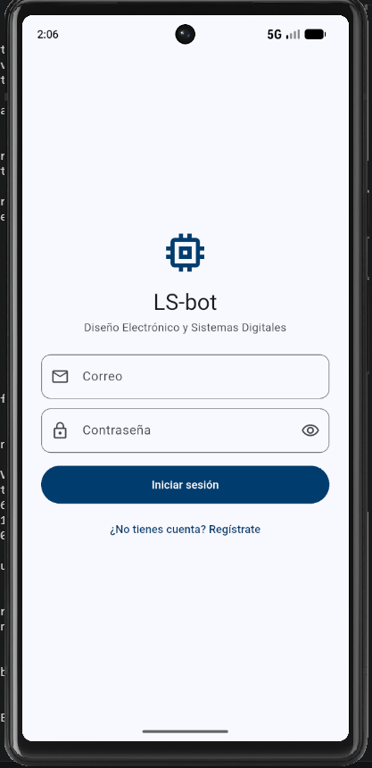
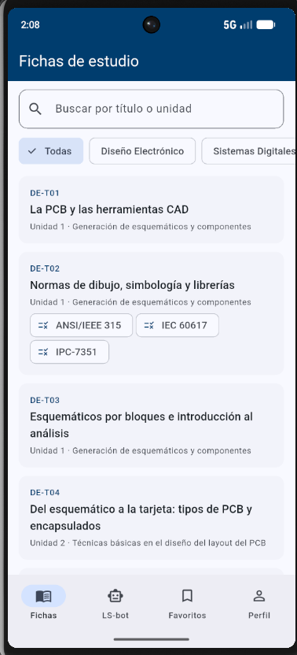
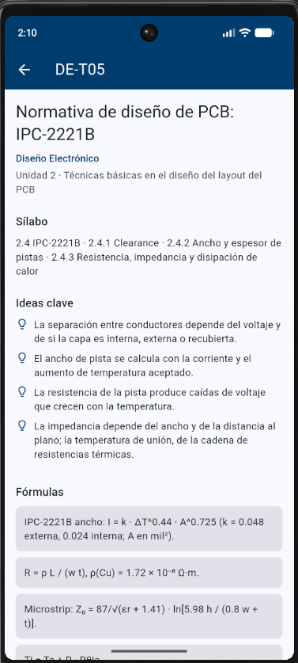
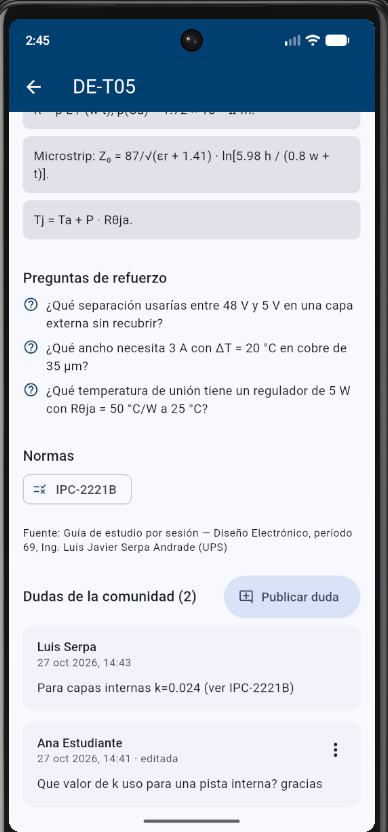
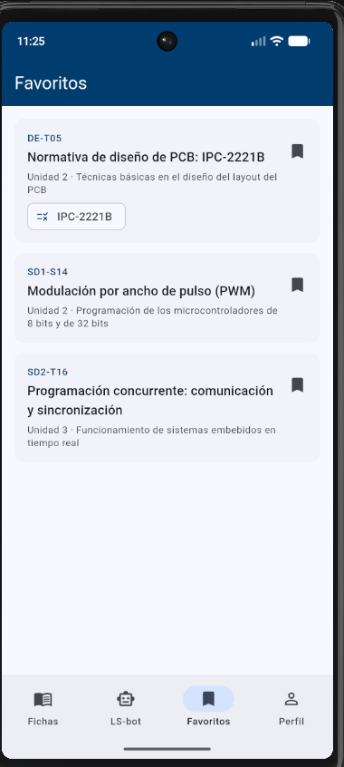
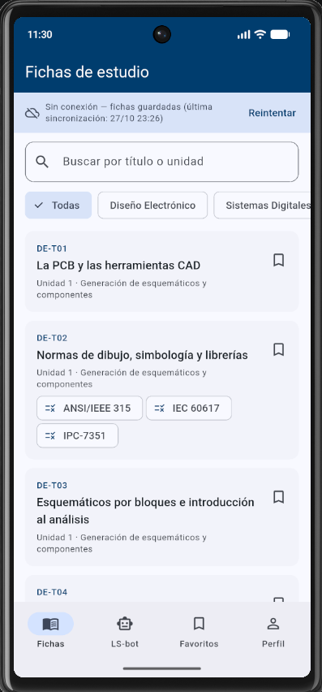
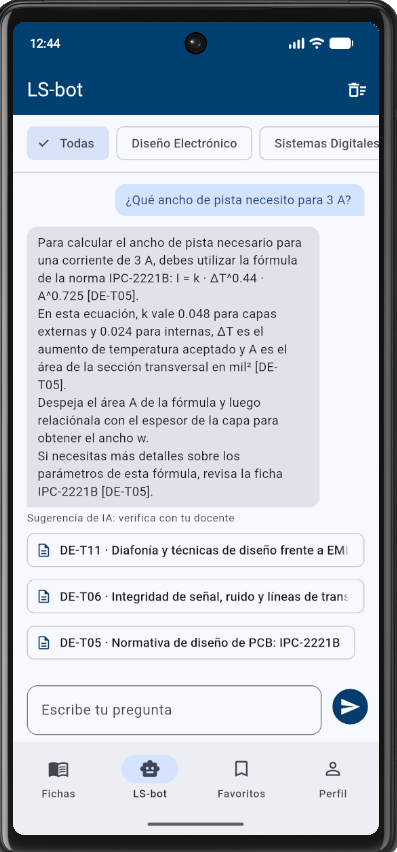
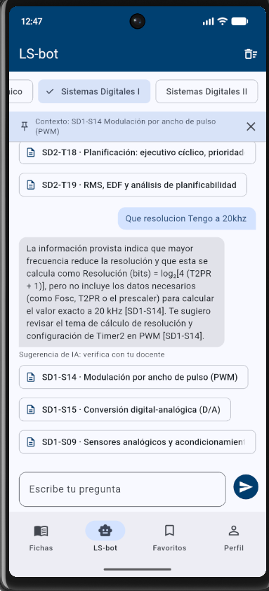
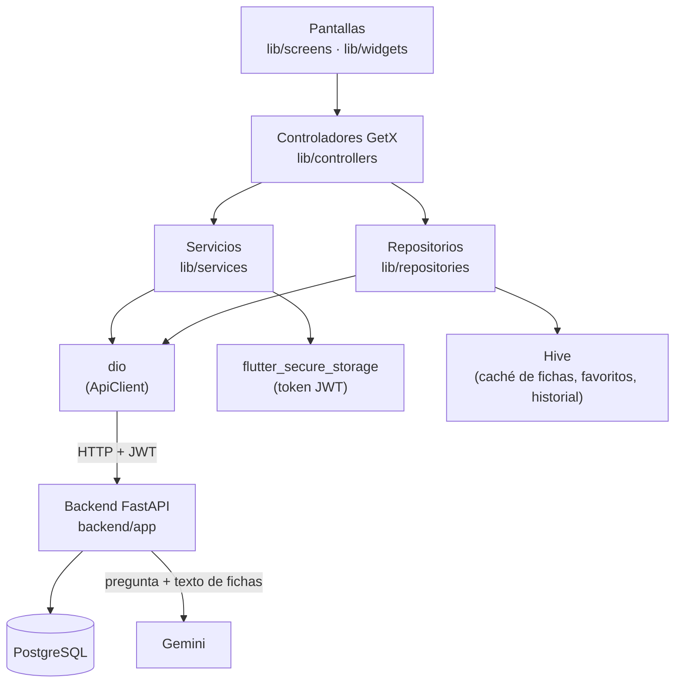

# LS-bot

App Android (Flutter) para estudiar **Diseño Electrónico**, **Sistemas Digitales I** y **Sistemas Digitales II** de la Universidad Politécnica Salesiana, con un asistente de IA que responde solo con el contenido de las fichas del curso.

## 1. Qué es LS-bot

LS-bot reúne **64 fichas de estudio**, una por sesión de clase: 14 de Diseño Electrónico, 25 de Sistemas Digitales I y 25 de Sistemas Digitales II. Cada ficha tiene un código (por ejemplo `DE-T01` o `SD1-S14`), su unidad y tema del sílabo, las ideas clave, las fórmulas, preguntas de repaso y las normas que aplican (citadas por nombre y sección). Las fichas viven en el backend y la app las consulta filtradas por materia.

La app es colaborativa: en cada ficha cualquier persona registrada puede **publicar dudas** que ven todos los usuarios, y solo su autor puede editarlas o borrarlas. Además, cada persona marca **fichas favoritas** que se guardan en el teléfono, y la lista de fichas queda en **caché**: si el servidor no responde, la app muestra las fichas guardadas con el aviso «Sin conexión» y la hora de la última sincronización.

El **asistente LS-bot** responde preguntas usando únicamente las fichas: el servidor busca las fichas más relacionadas con la pregunta (hasta tres), se las entrega a Gemini y la respuesta cita los códigos de las fichas usadas. Cada respuesta muestra sus fuentes, que se pueden tocar para abrir la ficha. Desde el detalle de una ficha se puede preguntar «sobre esta ficha» (queda como contexto de la búsqueda). Sin clave de Gemini, el servidor responde en **modo reglas** con las ideas clave de la ficha más relacionada.

## 2. Capturas

| | |
|:---:|:---:|
| <br>**Inicio de sesión** | <br>**Lista de fichas por materia** |
| <br>**Detalle de una ficha** | <br>**Dudas colaborativas** |
| <br>**Favoritos guardados en el teléfono** | <br>**Aviso «Sin conexión» con fichas en caché** |
| <br>**LS-bot responde y cita sus fuentes** | <br>**Pregunta con una ficha como contexto** |

## 3. Requisitos

- **Flutter 3.38.4 o superior** (Dart 3.13), canal estable. Compruébalo con `flutter --version`.
- **Android SDK** con un **emulador** creado en Android Studio (Device Manager) y `adb` en el `PATH`.
- **Docker Desktop** encendido (levanta la API y PostgreSQL).
- **Git**.
- Python solo hace falta para generar la `SECRET_KEY`; si no lo tienes, hay una alternativa con Docker más abajo.

```powershell
git clone https://github.com/luiserpandrade-bot/LS-BOT.git
cd LS-BOT
```

## 4. Cómo levantar el backend

Todos los comandos son para **PowerShell**, desde la raíz del repositorio.

```powershell
cd backend
Copy-Item .env.example .env
```

Genera una `SECRET_KEY` (firma de los JWT):

```powershell
python -c "import secrets; print(secrets.token_urlsafe(48))"
# Sin Python instalado:
docker run --rm python:3.12-slim python -c "import secrets; print(secrets.token_urlsafe(48))"
```

Abre `backend/.env` con un editor (por ejemplo `notepad .env`) y completa:

| Variable | Qué poner |
|---|---|
| `POSTGRES_PASSWORD` | Una clave propia. **Ponla antes del primer arranque**: PostgreSQL la fija al crear el volumen `lsbot-datos`. |
| `SECRET_KEY` | La cadena que acabas de generar. |
| `GEMINI_API_KEY` | Opcional. Una clave gratuita de <https://aistudio.google.com/apikey>. Si la dejas vacía, LS-bot responde en **modo reglas**. |
| `POSTGRES_DB`, `POSTGRES_USER`, `MINUTOS_TOKEN`, `GEMINI_MODEL`, `PERMITIR_ERRORES_DE_PRUEBA` | Se pueden dejar como vienen. |

Levanta la API y la base de datos:

```powershell
docker compose up --build
```

Al arrancar, la API crea las tablas y siembra las 64 fichas. Comprueba en el navegador:

- <http://localhost:8000/health> → `{"status":"ok","db":"ok"}`
- <http://localhost:8000/docs> → documentación interactiva de la API (Swagger).

> Si cambiaste `POSTGRES_PASSWORD` después del primer arranque, la base conserva la clave anterior y la API no conecta. Borra el volumen (se pierden usuarios y dudas) y vuelve a levantar: `docker compose down -v` y luego `docker compose up --build`.

**Pruebas del backend** (en otra terminal, dentro de `backend/`):

```powershell
docker compose run --rm api python -m pytest -q
```

## 5. Cómo ejecutar la app

Con el backend encendido y el emulador abierto, desde la raíz del repositorio:

```powershell
flutter pub get
flutter run
```

La dirección del backend se define al compilar con `--dart-define=API_BASE_URL` (ver `lib/config/api_config.dart`):

| Entorno | Dirección | Comando |
|---|---|---|
| Emulador Android (por defecto) | `http://10.0.2.2:8000` | `flutter run` |
| Dispositivo físico (misma red wifi que el PC) | `http://<IP-del-PC>:8000` | `flutter run --dart-define=API_BASE_URL=http://<IP-del-PC>:8000` |

La IP del PC se ve con `ipconfig` (dirección IPv4 del adaptador wifi). Si el teléfono no llega, revisa que el firewall de Windows permita el puerto 8000.

**Pruebas de la app:**

```powershell
flutter analyze
flutter test
```

## 6. Instalar el APK del Release

1. Descarga `app-release.apk` desde [Releases → v1.0.0](https://github.com/luiserpandrade-bot/LS-BOT/releases/tag/v1.0.0). Lo compila y publica GitHub Actions (`.github/workflows/release-apk.yml`) al subir una etiqueta `v*`.
2. Con el emulador abierto, si antes instalaste una versión de depuración (con `flutter run`), desinstálala; la firma es distinta y la instalación fallaría:

   ```powershell
   adb uninstall ec.edu.ups.lsbot
   ```

3. Instala el APK (desde la carpeta donde lo descargaste):

   ```powershell
   adb install -r app-release.apk
   ```

El APK apunta a `http://10.0.2.2:8000`, así que el backend debe estar encendido (sección 4) **en el mismo PC donde corre el emulador**.

## 7. Cómo probarlo en 5 minutos

1. **Dos cuentas.** Registra una cuenta A, cierra sesión desde **Perfil** y registra una cuenta B (puedes alternar entre ambas).
2. **Dudas colaborativas.** Con A, abre una ficha y publica una duda. Cierra sesión, entra con B y abre la misma ficha: la duda de A aparece, pero B no puede editarla ni borrarla.
3. **Favoritos.** Marca dos o tres fichas como favoritas, cierra la app por completo (desde «recientes») y ábrela: siguen en **Favoritos**.
4. **Sin conexión.** Apaga el backend (`Ctrl+C` en la terminal de `docker compose up`, o `docker compose stop api`) y desliza hacia abajo la lista de fichas: aparece el aviso «Sin conexión — fichas guardadas» con la hora de la última sincronización. Vuelve a encender el backend con `docker compose up`.
5. **LS-bot.** En el asistente pregunta, por ejemplo, «¿Cómo se calcula el ancho de una pista según IPC-2221B?» o «¿Qué es un RTOS?». La respuesta cita códigos de ficha; toca una **fuente** para abrir esa ficha. Desde el detalle de una ficha, usa «Preguntar a LS-bot sobre esta ficha» para preguntar con contexto.

## 8. Arquitectura



| Carpeta | Contenido |
|---|---|
| `lib/config/` | Dirección del backend (`API_BASE_URL`). |
| `lib/controllers/` | Estado compartido con GetX: sesión, fichas, dudas, favoritos, asistente y navegación. |
| `lib/services/` | Cliente `dio`, servicios por recurso, traducción de errores HTTP y almacenamiento seguro del token. |
| `lib/repositories/` | Combinan servidor y Hive: caché de fichas, favoritos e historial del chat. |
| `lib/screens/` | Pantallas (solo interfaz). |
| `lib/widgets/` | Piezas reutilizables: carga, vacío, error, aviso sin conexión, tarjetas, dudas, burbujas del chat. |
| `lib/models/` | Usuario, materia, ficha, duda, mensaje y respuesta del asistente. |
| `lib/utils/`, `lib/theme/` | Fechas, validadores y tema visual. |
| `test/` | Pruebas de widgets y servicios con un servidor falso (`test/apoyo/`). |
| `backend/app/` | API FastAPI: configuración, base de datos, modelos, seguridad JWT, siembra y lógica del asistente. |
| `backend/app/routers/` | Rutas `/usuarios`, `/fichas` (y sus dudas) y `/asistente`. |
| `backend/app/data/` | `fichas.json`: las 64 fichas que se siembran en la base. |
| `backend/tests/` | Pruebas del backend (SQLite en memoria). |
| `.github/workflows/` | CI (`ci.yml`) y publicación del APK (`release-apk.yml`). |
| `docs/` | Capturas, plantilla del README y lista de verificación. |

**Cómo viaja un dato.** La pantalla de fichas le pide la lista a `FichasController`; este llama a `FichasRepository`, que usa `FichasService` (sobre el `ApiClient` de `dio`, que agrega el token guardado en `flutter_secure_storage`) para pedir `GET /fichas/` al backend. FastAPI lee las fichas de PostgreSQL y devuelve JSON. El repositorio guarda la lista en la caja Hive `fichas_cache` y el controlador actualiza la pantalla. Si falla la conexión o el servidor, el repositorio devuelve la copia de Hive con su hora de sincronización y la pantalla muestra el aviso «Sin conexión»; un 401 u otro 4xx no usan la caché.

**Rutas del backend:** `POST /usuarios/`, `POST /usuarios/token`, `GET /usuarios/me`; `GET /fichas/materias`, `GET /fichas/`, `GET /fichas/{id}`; `GET` y `POST /fichas/{id}/dudas`, `PATCH` y `DELETE /dudas/{id}`; `POST /asistente/`; `GET /health`.

## 9. Decisiones técnicas

**Backend FastAPI propio en lugar de Firebase.** El asistente necesita un servidor propio: la clave de Gemini no puede ir dentro del APK y la búsqueda de fichas tiene que ejecutarse antes de llamar al modelo. Con FastAPI un solo servidor resuelve usuarios, fichas, dudas y asistente, con el mismo stack del curso (FastAPI + PostgreSQL + JWT en Docker). *Se descartó* Firebase (Auth + Firestore) porque igual hacía falta un servidor aparte para el asistente: habría dos plataformas que mantener en lugar de una.

**Recuperación de fichas por palabras clave con IDF en lugar de embeddings.** `backend/app/asistente.py` normaliza la pregunta (minúsculas, sin tildes, sin palabras vacías, sin plurales), da a cada palabra un peso IDF (más peso cuanto menos fichas la contienen), suma un 50 % si aparece en el título, normaliza por el tamaño de la ficha y prioriza la ficha de contexto. No agrega dependencias ni costo, se puede explicar y probar línea por línea, y es suficiente para 64 fichas con vocabulario técnico muy específico (PWM, Timer0, IPC-2221B, VHDL…). *Se descartaron* los embeddings (y una base vectorial) por ahora: suman una dependencia y llamadas extra a una API; quedan como mejora.

## 10. Seguridad

- **Claves fuera del repositorio.** `SECRET_KEY`, `POSTGRES_PASSWORD` y `GEMINI_API_KEY` viven solo en `backend/.env`, que está en `.gitignore`. `backend/.env.example` documenta las variables sin valores reales. La app no contiene ninguna clave: solo conoce la dirección del backend.
- **JWT.** El backend firma los tokens con `SECRET_KEY` (duración `MINUTOS_TOKEN`) y guarda las contraseñas con bcrypt. La app guarda el token en `flutter_secure_storage` y nunca lo imprime.
- **Autoría de las dudas.** Todos ven las dudas, pero solo el autor puede editarlas o borrarlas; otro usuario recibe **403**.
- **Qué viaja al modelo.** A Gemini solo llegan la pregunta y el texto de las fichas relacionadas; nunca datos del usuario. La clave viaja en una cabecera (`x-goog-api-key`), no en la URL.
- **Historial del chat.** Se guarda en Hive por usuario y se borra del disco al cerrar sesión.
- **Registros sin tokens.** El backend registra método, ruta, código y tiempo de cada petición, sin cabeceras ni cuerpos; del asistente solo registra la longitud de la pregunta y cuántas fichas encontró.

**Cómo auditarlo** (en Git Bash; en PowerShell usa `git grep -niE` en lugar de `grep -rniE`):

```bash
# Ninguna clave en el código de la app ni en el ejemplo de variables
grep -rniE "api[_-]?key|sk-[a-z0-9]{10}|secret" lib backend/.env.example
git grep -nE "AIza[0-9A-Za-z_-]{20,}"        # formato de clave de Google: no debe dar resultados

# .env ignorado y nunca subido
git check-ignore -v backend/.env
git log --all --oneline -- backend/.env .env  # debe salir vacío
```

El primer `grep` solo debe mostrar nombres de variables y comentarios (por ejemplo `GEMINI_API_KEY=` vacío en `backend/.env.example`), nunca un valor.

## 11. Uso de un agente de código

El proyecto se desarrolló con **Claude Code** trabajando dentro de un arnés versionado en el repositorio:

- `AGENTS.md`: qué es el proyecto, arquitectura, convenciones (capas, español neutro, estados de carga/vacío/error), cómo verificar y lo prohibido (claves en el código, leer `.env`, copiar normas, dependencias sin avisar, `git push` y etiquetas).
- `CLAUDE.md`: importa `AGENTS.md` y exige el **modo plan** antes de cualquier cambio que toque más de un archivo.
- `.claude/settings.json`: permite solo `flutter analyze`, `flutter test`, `dart format`, `git status` y `git diff` sin preguntar, y **prohíbe** leer `.env`, `.env.*` y `backend/.env`, `git push` y `git tag`.

En cada fase el flujo fue: plan del agente revisado y aprobado, cambio, **revisión del diff** por el autor y **verificación propia** (`flutter analyze`, `flutter test`, pytest del backend y prueba en el emulador). Cada fase entró a `main` por **pull request** con la CI (`.github/workflows/ci.yml`) en verde.

## 12. Créditos y licencias

**Contenido.** Las fichas son de redacción propia del docente, a partir de sus guías de estudio por sesión (período 69). Citan normas **IPC, IEC, ISO, IEEE y CISPR** por nombre y sección, sin reproducir su texto; las normas pertenecen a sus respectivos organismos.

**Paquetes de terceros:**

| Paquete | Uso | Licencia |
|---|---|---|
| [get](https://pub.dev/packages/get) | Estado, dependencias y navegación | MIT |
| [dio](https://pub.dev/packages/dio) | Cliente HTTP | MIT |
| [flutter_secure_storage](https://pub.dev/packages/flutter_secure_storage) | Token JWT cifrado | BSD-3-Clause |
| [hive](https://pub.dev/packages/hive), [hive_flutter](https://pub.dev/packages/hive_flutter) | Caché, favoritos e historial | Apache-2.0 |
| [FastAPI](https://fastapi.tiangolo.com/) | API del backend | MIT |
| [SQLAlchemy](https://www.sqlalchemy.org/) | Acceso a la base de datos | MIT |
| [PyJWT](https://pyjwt.readthedocs.io/) | Firma y verificación de JWT | MIT |
| [bcrypt](https://pypi.org/project/bcrypt/) | Hash de contraseñas | Apache-2.0 |
| [httpx](https://www.python-httpx.org/) | Llamadas a Gemini | BSD-3-Clause |
| [PostgreSQL](https://www.postgresql.org/) | Base de datos | PostgreSQL License |

**IA.** Las respuestas del asistente las genera [Gemini](https://ai.google.dev/) de Google mediante su plan gratuito. En ese plan, Google puede usar las consultas para mejorar sus productos: no escribas datos personales en las preguntas.

**Autor:** Ing. Luis Javier Serpa Andrade — Universidad Politécnica Salesiana.

## 13. Siguientes pasos

- Desplegar el backend en un servidor para uso 24/7 (hoy debe correr en el PC del emulador) y compilar el APK con esa dirección mediante la variable `API_BASE_URL` del workflow.
- Probar embeddings para la búsqueda de fichas y compararlos con la recuperación por IDF.
- Agregar más fichas y materias.
